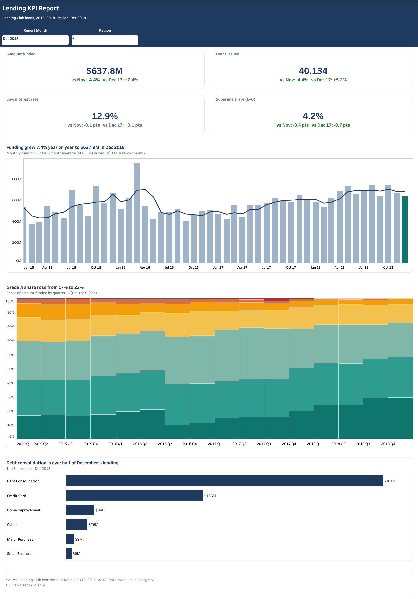

# Lending Club KPI Report

Monthly lending KPI report on 1.79 million Lending Club loans issued between 2015 and 2018, built with PostgreSQL and Tableau Public.

The SQL takes the raw Kaggle file through staging, a star schema and reporting marts. The Tableau report sits on top and shows how much was lent each month and how it compares with the previous month and the same month last year.

**Live report:** link coming soon (Tableau Public)



## What the report shows

- Four KPI tiles for the selected month: amount funded, loans issued, average interest rate and subprime share (grades E-G), each compared with the previous month and the same month last year
- Monthly funding since 2015 with a 3-month moving average
- Grade mix of the money lent, quarter by quarter
- Top 6 loan purposes for the selected month
- Report Month and Region filters

## Dec 2018 at a glance

| KPI | Dec 2018 | vs Nov 2018 | vs Dec 2017 |
| --- | --- | --- | --- |
| Amount funded | $637.8M | -4.4% | +7.4% |
| Loans issued | 40,134 | -4.4% | +5.2% |
| Avg interest rate | 12.9% | -0.1 pts | +0.1 pts |
| Subprime share (E-G) | 4.2% | -0.4 pts | -0.7 pts |

Debt consolidation was $381M of the $637.8M lent in Dec 2018, more than half of the month.

## Data

Lending Club accepted loans 2007-2018 from Kaggle ([All Lending Club loan data](https://www.kaggle.com/datasets/wordsforthewise/lending-club)), CC0 licence.
The raw file is 1.6 GB, so it's not in this repo. Download `accepted_2007_to_2018Q4.csv` and put it in `data/`.

## Pipeline

```
Kaggle CSV (2.26M rows, 151 cols)
  -> DuckDB extract (2015-2018, 29 cols, skips broken rows)
  -> raw      all text, never edited
  -> stg      cleaned and typed
  -> dw       star schema: fact_loan + month, grade, purpose, state dims
  -> mart     reporting views
  -> CSV exports -> Tableau Public
```

| Script | What it does |
| --- | --- |
| `sql/01_extract_duckdb.sql` | DuckDB extract from the raw file (it has rows with broken quotes that Postgres COPY can't skip) |
| `sql/02_raw_load.sql` | schemas and the raw table |
| `sql/03_stg_loans.sql` | casts, date parsing, loan status mapping |
| `sql/04_dimensions.sql` | month, grade, purpose and state dimensions |
| `sql/05_fact_loan.sql` | loan fact table with status flags and loss amounts |
| `sql/06_marts.sql` | reporting views, including `loan_monthly` and `kpi_monthly` used by this report |
| `sql/07_dq_tests.sql` | data quality checks, one PASS/FAIL row per test |
| `sql/08_exports.sql` | exports the marts to CSV for Tableau |

`06_marts.sql` also builds credit risk views (vintage curves, PD/LGD, expected loss). They're for a second dashboard I'm working on next.

## SQL used

- Text cleaning with `regexp_replace`, `NULLIF` and `to_date`
- Star schema with primary keys, foreign keys and indexes
- Window functions: `LAG` for MoM / YoY, `SUM` for YTD, `AVG` over 3 rows for the moving average, `RANK`
- `FILTER` clauses for conditional aggregates such as subprime share
- A one-query test suite for row counts, keys, ranges and reconciliation

## KPI definitions

| KPI | Definition |
| --- | --- |
| Amount funded | sum of funded amount in the month |
| Loans issued | count of loans issued in the month |
| Avg interest rate | rate weighted by amount funded: sum(rate x amount) / sum(amount) |
| Subprime share | funded amount in grades E-G / total funded |
| MoM / YoY | change vs the previous month / the same month last year; rates and shares in percentage points |

## How to run

1. Put the Kaggle file in `data/`.
2. Run `sql/01_extract_duckdb.sql` in DuckDB.
3. Run `sql/02_raw_load.sql` in Postgres, then import `data/lc_loans_2015_2018.csv` into `raw.lc_loans`.
4. Run `sql/03` to `sql/07` in order (all tests should PASS).
5. Run `sql/08_exports.sql` and open the CSVs in Tableau.

Built with PostgreSQL 18, pgAdmin 4, DuckDB and Tableau Public.

Deepak Mishra | [LinkedIn](https://www.linkedin.com/in/md64) | [Tableau Public](https://public.tableau.com/app/profile/deepak.mishra6411)
